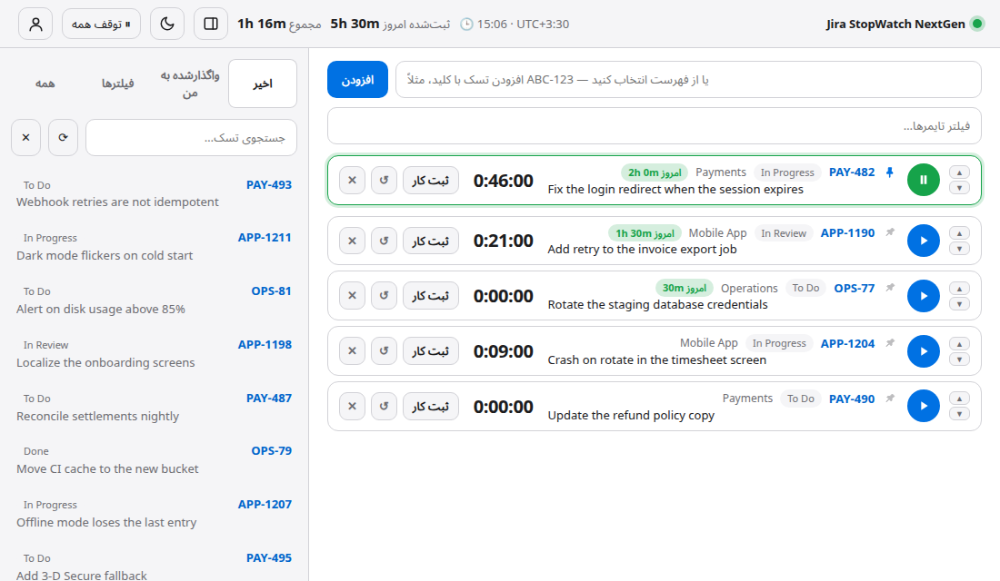
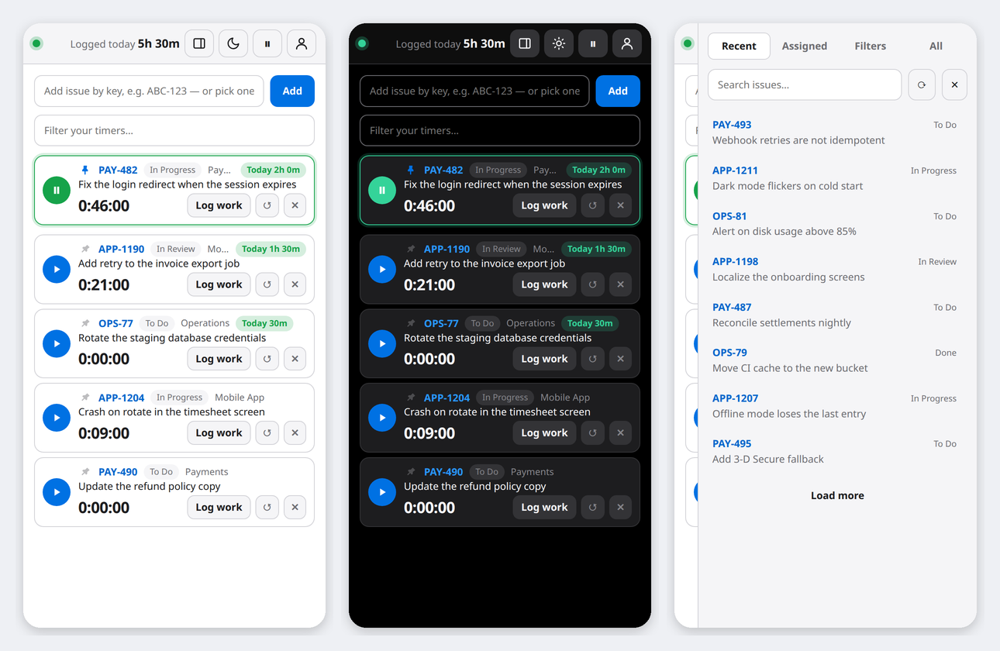

<div align="center" dir="rtl">

# JiraStopWatch NextGen

**تایمر سریع و مدرن برای ثبت زمان در Jira — برای ویندوز و لینوکس** (پشتیبانی مک آماده‌سازی شده ولی فعلاً در دسترس نیست؛ بخش «مک» را ببینید.)

[](https://github.com/farhadrezvani7/jirastopwatch-nextgen/actions/workflows/ci.yml)
[](LICENSE)

[English](README.md) · [فارسی](README.fa.md)



</div>

<div dir="rtl">

JiraStopWatch NextGen بر پایه‌ی هسته‌ی پروژه‌ی متن‌باز [**jirastopwatch**](https://github.com/jirastopwatch/jirastopwatch) ساخته شده است (ابزار دسکتاپ ویندوز برای ثبت زمان روی تسک‌های Jira). هر آنچه در نسخه‌ی اصلی مفید بود حفظ شده و بعد از آن **ارتقا یافته، بازطراحی شده و به زبان Go بازنویسی شده** تا سبک‌تر باشد، فوراً اجرا شود و به‌صورت بومی روی **ویندوز، مک و لینوکس** کار کند.

روی یک تسک تایمر را روشن کنید، کار کنید، **Log work** را بزنید — زمان به‌صورت worklog در Jira ثبت می‌شود، با **منطقه‌ی زمانی شما** و به **زبان شما**.

**ریسپانسیو** — چیدمان تا عرض موبایل سازگار می‌شود و لیست تسک‌ها به‌صورت پنل کشویی درمی‌آید.

<div align="center"></div>

---

## نصب (با دو کلیک)

فقط یک مرورگر مبتنی بر Chromium لازم است که تقریباً روی همه‌ی کامپیوترها هست: **Edge** (روی ویندوز ۱۰ و ۱۱ از قبل نصب است)، **Chrome**، **Brave** یا **Chromium**. نه runtime می‌خواهد، نه دسترسی ادمین، نه ترمینال.

فایل مخصوص سیستم‌تان را از صفحه‌ی [**Releases**](https://github.com/farhadrezvani7/jirastopwatch-nextgen/releases/latest) دانلود کنید:

### ویندوز
۱. فایل `jirastopwatch-nextgen-windows-amd64-setup.exe` را دانلود کنید (روی کامپیوترهای ARM فایل `…-arm64-setup.exe`).
۲. روی آن دوبار کلیک کنید ← **Next** ← **Finish**. برنامه در Start Menu و روی دسکتاپ می‌آید و هر زمان از *Settings ← Apps* حذف می‌شود. برای سنجاق کردن در نوار وظیفه، ورودی Start Menu را سنجاق کنید (نه پنجره‌ی باز را؛ ویندوز آن را به مرورگر نسبت می‌دهد).
   بار اول ممکن است SmartScreen پیام *Windows protected your PC* بدهد (چون فایل امضای دیجیتال ندارد): روی **More info ← Run anyway** بزنید.

### مک
> ⚠️ **فعلاً امکان استفاده روی مک وجود ندارد.** زیرساخت مک در پروژه پیاده‌سازی شده است (بسته‌ی `.app`، امضا در workflow انتشار و خودِ بیلد)، ولی اجرای برنامه روی مک نیاز به یک **حساب Apple Developer** (اشتراک پولی سالانه) دارد تا برنامه امضا و notarize شود و macOS اجازه‌ی باز کردنش را بدهد؛ و ما هنوز چنین حسابی نداریم. تا آن زمان **فقط کاربران ویندوز و لینوکس می‌توانند نصب کنند**. فایل‌های مک که کنار نسخه‌ها هست فقط برای توسعه‌دهندگان و بدون پشتیبانی است. با فراهم شدن حساب اپل، پشتیبانی مک فعال و همین‌جا اعلام می‌شود.

### لینوکس
- **اوبونتو / دبیان / مینت:** فایل `jirastopwatch-nextgen-linux-amd64.deb` (یا `…-arm64.deb`) را دانلود کنید، روی آن دوبار کلیک کنید و در نرم‌افزار سنتر **Install** بزنید.
- **فدورا / openSUSE:** فایل `.rpm` را به همین شکل نصب کنید.
- **هر توزیعی، با یک خط** (فقط برای کاربر خودتان، بدون root):
</div>

```bash
curl -fsSL https://raw.githubusercontent.com/farhadrezvani7/jirastopwatch-nextgen/main/install.sh | bash
```

<div dir="rtl">

  بعد از آن در منوی برنامه‌ها دنبال **Jira StopWatch NextGen** بگردید. ترمینال فقط برای همین یک دستور لازم است و خود برنامه مستقل اجرا می‌شود.
- فایل ساده‌ی `jirastopwatch-nextgen-linux-*` را دانلود کرده‌اید؟ با `chmod +x` اجرایی‌اش کنید و با `--install` اجرا کنید؛ حذف: `--uninstall`.

> مرورگر Chromium ندارید؟ برنامه در مرورگر پیش‌فرض باز می‌شود و با بستن آن تب، بسته می‌شود.

### به‌روزرسانی
روی آیکون پروفایل (بالا) کلیک کنید ← **Check for updates**. اگر نسخه‌ی جدیدی منتشر شده باشد، با تأیید شما برنامه آن را دانلود می‌کند، صحت فایل را با checksum بررسی می‌کند، خودش را جایگزین می‌کند و دوباره اجرا می‌شود؛ بدون حذف و نصب دستی. تایمرهای در حال اجرا باید ابتدا متوقف یا ثبت شوند (دیالوگ دکمه‌ی *Pause all & update* را پیشنهاد می‌دهد)؛ تایمرهای متوقف زمان خود را نگه می‌دارند. نسخه‌هایی که برای همه‌ی کاربران نصب شده‌اند (مثلاً `.deb` یا `.rpm` در `/usr/bin`) برای جایگزین شدن، رمز مدیر سیستم را می‌پرسند (polkit/`pkexec`)؛ اگر `pkexec` نباشد دیالوگ به‌جای آن لینک دانلود را نشان می‌دهد.

### ساخت از روی سورس (هر سیستم‌عامل)
</div>

```bash
git clone https://github.com/farhadrezvani7/jirastopwatch-nextgen.git
cd jirastopwatch-nextgen
go build -o jirastopwatch-nextgen .        # نیاز به Go 1.24 به بالا
./jirastopwatch-nextgen
```

<div dir="rtl">

---

## اولین ورود (یک دقیقه)
۱. آدرس Jira را وارد کنید (مثلاً `yourcompany.atlassian.net`).
۲. توکن بگیرید:
   - **Jira Cloud:** به <https://id.atlassian.com/manage-profile/security/api-tokens> بروید ← *Create API token*. با ایمیل + همین توکن وارد شوید.
   - **Jira Server / Data Center:** آواتار ← *Profile* ← *Personal Access Tokens* ← *Create token* (یا نام کاربری + رمز عبور).
۳. گزینه‌ی **Remember me** به‌طور پیش‌فرض روشن است و دفعه‌ی بعد خودکار وارد می‌شوید؛ روی کامپیوتر مشترک آن را بردارید.
۴. تسک‌ها را با کلید (`ABC-123`)، با چسباندن لینک Jira، یا از *Recent / Assigned / Filters* اضافه کنید.

---

## چه چیزی نسبت به jirastopwatch اصلی ارتقا یافته؟

نسخه‌ی اصلی یک برنامه‌ی دسکتاپ C# / WinForms / .NET Framework فقط برای ویندوز است. NextGen جریان کاری اصلی آن را نگه داشته و تقریباً همه‌چیز اطرافش را بهبود داده است.

| | jirastopwatch اصلی | **JiraStopWatch NextGen** |
|---|---|---|
| **پلتفرم** | فقط ویندوز | **ویندوز و لینوکس** (x64 و ARM)؛ مک در انتظار حساب Apple Developer |
| **فناوری** | C#، WinForms، .NET Framework، RestSharp | **Go**، یک فایل مستقل، رابط وب داخلی |
| **نصب** | نصب‌کننده‌ی MSI + .NET | **یک فایل را دانلود و اجرا کنید** — بدون نصب‌کننده و runtime |
| **حجم و منابع** *(اندازه‌گیری‌شده روی لینوکس)* | — | حدود ۶٫۵ مگابایت · آماده‌شدن سرور در حدود ۴۰ میلی‌ثانیه · حدود ۱۰ مگابایت RAM برای پردازش سرور (پنجره‌ی مرورگر جدا حساب می‌شود) |
| **رابط کاربری** | پنجره‌ی WinForms | رابط مدرن **بازطراحی‌شده** با **تم روشن و تیره**، ساعت زنده |
| **زبان** | انگلیسی | **۴۱ زبان** قابل جستجو، با چیدمان کامل **راست‌به‌چپ** (فارسی، عربی، اردو، عبری، کردی، پشتو) |
| **منطقه‌ی زمانی** | ساعت محلی کامپیوتر | **انتخاب کشور (هر ۲۴۷ کشور) ← worklog با منطقه‌ی زمانی آن** — دیگر محاسبه‌ی دستی ۳:۳۰ لازم نیست |
| **ورود** | نام کاربری + توکن API | **Cloud** (ایمیل + توکن)، **توکن شخصی Server/DC**، یا نام کاربری + رمز |
| **سازگاری با Jira Cloud امروز** | برای Cloud فعلی به اصلاح نیاز دارد | داخلی: endpoint جستجوی نسخه‌ی ۳، تشخیص ریدایرکت و صفحه‌ی HTML ورود |
| **جستجو** | جستجوی تسک | جستجوی تسک **و** انتخابگرهای قابل جستجوی زبان/کشور/منطقه، فیلترهای محبوب و فیلتر تایمرهای خودتان |
| **ثبت کار** | زمان، کامنت، تخمین | همان‌ها **به‌علاوه** تغییر وضعیت تسک در همان مرحله و نمایش تخمین باقی‌مانده |
| **امنیت محلی** | — | سرور فقط روی `127.0.0.1`، توکن مخفی در هر اجرا، بررسی Host |
| **فایل‌های داده** | تنظیمات باینری | JSON خوانا، نوشتن اتمیک، دسترسی فقط برای صاحب فایل |
| **تست** | NUnit | تست‌های Go که CI روی **ویندوز و لینوکس** (و برای زیرساخت، مک) اجرا می‌کند |

### همه‌ی امکانات نسخه‌ی اصلی که حفظ شده
چند استاپ‌واچ · توقف بقیه هنگام شروع یکی · ویرایش زمان · تنظیم تخمین باقی‌مانده · ثبت کامنت داخل worklog، جدا، یا هر دو · انتقال تسک به وضعیتی مثل *In Progress* هنگام شروع تایمر · توقف با قفل سیستم · انتخاب رفتار هنگام خروج · میان‌برهای کیبورد · اعلان به‌روزرسانی (اختیاری) · حداکثر ۲۰ تسک · مجوز Apache 2.0.

---

## امکانات
- ⏱ **تایمری که زمان را از دست نمی‌دهد** — با بسته بودن پنجره هم می‌شمارد و در اجرای بعد برمی‌گردد. کامنت‌های ارسال‌نشده هم می‌مانند.
- 🌍 **منطقه‌ی زمانی بر اساس کشور** — هر ۲۴۷ کشور؛ کشورهای چندمنطقه‌ای انتخابگر منطقه دارند.
- 🗣 **۴۱ زبان** — با انتخاب کشور، زبان اصلی آن پیشنهاد می‌شود.
- 🎨 **تم روشن و تیره** — از هدر، صفحه‌ی ورود یا تنظیمات؛ حالت *Auto* از سیستم‌عامل پیروی می‌کند.
- 🔎 **جستجو در همه‌ی جاهای لازم**.
- 🔒 **توقف با قفل سیستم** (لینوکس با systemd-logind، ویندوز، مک).
- 🔗 **چسباندن لینک Jira** — `Ctrl+V` تسک را از لینک اضافه می‌کند.
- 🕒 **آگاه از ساعت سرور Jira** — Jira لحظه‌ی دقیق را ذخیره می‌کند، ولی گزارش‌هایش روز را بر اساس منطقه‌ی زمانی *سرور* حساب می‌کنند. اگر با منطقه‌ی شما (و پروفایل Jira شما) فرق داشته باشد، برنامه خبر می‌دهد و اگر بخواهید ساعت محلی شما را روی ساعت سرور می‌نویسد تا گزارش‌ها روی روز درست بنشینند؛ هر زمان از تنظیمات می‌توانید برگردید (وقتی ساعت سرور درست شود، خود برنامه هم پیشنهادش را می‌دهد).
- 🔑 **وارد ماندن** — توکن در مخزن امن سیستم‌عامل نگه داشته می‌شود و برنامه هنگام باز شدن خودش وارد می‌شود.
- 📊 **ثبت‌شده امروز** — هدر مجموع زمانی را که امروز در Jira ثبت کرده‌اید (روی همه‌ی تسک‌ها، با منطقه‌ی زمانی انتخابی) نشان می‌دهد و هر کارت جمع امروزِ همان تسک را؛ پس حتی چندین worklog روی یک تیکت هم یک‌جا دیده می‌شود. این عدد مستقیم از خود Jira می‌آید، پس حتی اگر وسط روز برنامه را نصب کرده باشید درست است. کنارش «هنوز ثبت‌نشده» زمانی را نشان می‌دهد که هنوز روی کارت‌های تایمر مانده (اگر نباشد، پنهان است).
- 📌 **پین کردن کارت‌ها** — آیکون پین کنار کلید تسک، آن کارت را بالای همه‌ی کارت‌ها نگه می‌دارد. پین فقط داخل خود برنامه ذخیره می‌شود (نه در Jira) و با بستن و باز کردن برنامه می‌ماند. کارت‌های پین‌شده بلوک جداگانه‌ی خودشان را دارند: کارت‌های تازه، استارت‌شده یا درگ‌شده هیچ‌وقت از آن‌ها بالاتر نمی‌روند، ▲▼ و درگ اند دراپ فقط داخل همان بلوک جابه‌جا می‌کنند و حذف کارت پین‌شده اول تأیید می‌گیرد.
- 🌐 **انتخاب مرورگر برای لینک‌های Jira** — در *Settings ← Open Jira issues in* هر مرورگری را که روی کامپیوتر نصب است انتخاب کنید (در ویندوز و لینوکس خودکار پیدا می‌شوند)، تا لینک تسک‌ها همان‌جایی باز شود که در Jira وارد شده‌اید. پیش‌فرض، مرورگر سیستم است؛ اگر مرورگر انتخابی حذف شده باشد، پیش‌فرض استفاده می‌شود. فقط صفحه‌های همان Jira خودتان از این راه باز می‌شوند.
- ⤴️ **تایمر استارت‌شده می‌رود بالای لیست** — اختیاری (در Settings): هر تایمری که استارت شود خودکار به بالای لیست می‌آید و لازم نیست دستی جابه‌جا کنید.
- 🔁 **ثبت و شروع دوباره** — دکمه‌ای در پنل ثبت کار که worklog را ثبت می‌کند و بلافاصله تایمر همان تسک را دوباره روشن می‌کند، بدون جستجوی دوباره.
- ✋ **درگ اند دراپ** — روی کارت نگه دارید و به جای دلخواه بکشید (▲▼ و `Ctrl+↑/↓` هم هست).
- 🎛 **ظاهر به سلیقه‌ی شما** — در *Settings* اندازه‌ی فونت پایه (۱۰ تا ۱۶ پیکسل، با پیش‌نمایش زنده) را انتخاب و سایه‌های ملایم را روشن یا خاموش کنید (پیش‌فرض: خاموش).
- 🔍 **همه‌ی تسک‌ها + جستجوی پیشرفته (JQL)** — تب *All* همه‌ی تسک‌هایی را که در Jira می‌بینید (از هر تیمی)، جدیدترین اول، با دکمه‌ی *Load more* نشان می‌دهد. در همین تب آیکون قیف یک کادر JQL باز می‌کند، مثلاً `status = Develop AND resolution = Unresolved AND labels = Flutter ORDER BY updated DESC`. Jira آن را با دسترسی خودِ شما اجرا می‌کند و خطای نحوی را با همان متن Jira نشان می‌دهد؛ آخرین کوئری شما یادآوری می‌شود.
- 👤 **پنجره‌ی پروفایل** — در هدر فقط یک آیکون پروفایل هست؛ با کلیک روی آن می‌بینید چه کسی وارد شده، «توقف بقیه» را روشن/خاموش می‌کنید و به تنظیمات، بررسی به‌روزرسانی یا خروج می‌روید.
- 📱 **ریسپانسیو و فشرده** — چیدمان تا عرض موبایل سازگار می‌شود (لیست تسک‌ها به‌صورت پنل کشویی درمی‌آید) و کارت‌های کم‌ارتفاع‌تر بدون اسکرول بیشتری جا می‌دهند.
- 🔔 **آیکون سینی سیستم** — در ویندوز و لینوکس‌هایی که سینی دارند: دسترسی سریع به پنجره، تولتیپ تایمر در حال اجرا، توقف همه و خروج.
- ⬆️ **به‌روزرسانی با یک کلیک** — *Check for updates* نسخه‌ی جدید را دانلود، بررسی و نصب می‌کند.

### میان‌برهای کیبورد (مثل نسخه‌ی اصلی)
`Ctrl+P` شروع/توقف · `Ctrl+L` ثبت کار · `Ctrl+E` ویرایش زمان · `Ctrl+R` بازنشانی · `Ctrl+Del` حذف · `Ctrl+↑/↓` جابه‌جایی · `Ctrl+O` باز کردن در Jira · `Ctrl+I` یا `Ctrl+N` فیلد افزودن · `Ctrl+C` کپی کلید · `Ctrl+V` افزودن کلید یا لینک چسبانده‌شده

---

## زمان شما در امان است
- **کرش یا قطعی برق** — تایمرها همان لحظه‌ی تغییر روی دیسک ذخیره می‌شوند؛ به شکلی که قطعی برق نتواند فایل خالی بر جا بگذارد (داده اول روی دیسک نوشته می‌شود و نسخه‌ی قبلی به‌عنوان پشتیبان می‌ماند و اگر فایل خراب شود خودکار استفاده می‌شود). تایمر در حال اجرا به‌صورت «زمان شروع» ذخیره می‌شود، پس با بسته شدنِ عادیِ برنامه شمارش ادامه دارد. پس از کرش یا قطعی برق، برنامه آخرین لحظه‌ی زنده بودنش را (هر ۲۰ ثانیه) ثبت کرده است؛ در اجرای بعد **از شما می‌پرسد** که کامپیوتر خاموش بوده یا نه — *برگرداندن به آن لحظه و توقف* یا *ادامه‌ی شمارش* — و هرگز خودش چیزی را در تایمرها تغییر نمی‌دهد؛ پس ساعت‌های خاموش بودن فقط با تأیید شما کم می‌شوند.
- **قطع شدن اینترنت هنگام ثبت** — چیزی از بین نمی‌رود: تایمر و یادداشت ارسال‌نشده سر جایشان می‌مانند و می‌توانید دوباره ثبت کنید. اگر Jira قبل از قطع شدن ارتباط، ثبت را ذخیره کرده بود، ثبت دوباره همان worklog یکسان (همان دقیقه‌ی شروع و همان مدت) را تشخیص می‌دهد و دوبار ثبت نمی‌کند. ابتدا worklog و بعد کامنت جدا ارسال می‌شود، پس خطا هرگز کامنت تکراری یا از دست رفتن زمان نمی‌سازد.
- **نبودن اینترنت هنگام باز کردن برنامه** — دکمه‌ی *Continue offline* تایمرها را باز می‌کند و با برگشتن اینترنت، اتصال به Jira خودکار برقرار می‌شود.
- **فقط یک نسخه‌ی در حال اجرا** — نسخه‌ی در حال اجرا یک قفل سطح سیستم‌عامل نگه می‌دارد (با مردن برنامه خودکار آزاد می‌شود)؛ پس اجرای دوباره‌ی برنامه فقط همان نسخه را نشان می‌دهد و دو نسخه هرگز تایمرهای هم را بازنویسی نمی‌کنند.
- **به‌روزرسانی** — تا وقتی تایمری در حال اجراست آپدیت انجام نمی‌شود (اول متوقف یا ثبت کنید؛ دیالوگ دکمه‌ی *Pause all & update* را پیشنهاد می‌دهد) و آپدیتی که با قطعی برق ناتمام بماند نسخه‌ی قدیمی را سالم می‌گذارد.
- **پر شدن دیسک / پوشه‌ی فقط‌خواندنی** — بلافاصله خبر می‌گیرید که تایمرها ذخیره نشده‌اند. اگر ساعت سیستم به عقب برود، زمانی که قبلاً شمرده شده کم نمی‌شود. رمز/توکن ورود هم هرگز در فایل‌های پشتیبان باقی نمی‌ماند.

## حریم خصوصی و امنیت
- داده‌ی شما **فقط به سایت Jira خودتان** می‌رود. (بررسی به‌روزرسانی فقط وقتی فعال است که هنگام ساخت مخزن انتشار تعیین شده باشد و از تنظیمات خاموش می‌شود.)
- سرور محلی فقط روی `127.0.0.1` و پورت تصادفی گوش می‌دهد و به یک رمز مخصوص هر اجرا نیاز دارد؛ پس سایت‌های دیگر و کاربران دیگر کامپیوتر به آن دسترسی ندارند.
- اگر **Remember me** روشن باشد، توکن در مخزن امن اطلاعات ورود سیستم‌عامل شما نگه داشته می‌شود: Credential Manager در ویندوز، Keychain در مک و Secret Service (مثل GNOME Keyring یا KWallet) در لینوکس که به دستور `secret-tool` از بسته‌ی `libsecret-tools` نیاز دارد. اگر هیچ‌کدام در دسترس نباشد، توکن در فایلی در پوشه‌ی تنظیمات برنامه می‌ماند که فقط کاربر شما می‌تواند بخواند و **رمزگذاری نشده** است. توکن‌های متنی نسخه‌های قبلی خودکار به مخزن امن منتقل می‌شوند. روی کامپیوترهای مشترک Remember me را خاموش کنید.

## مواردی که (نسبت به نسخه‌ی اصلی) وجود ندارد
فایل لاگ تشخیصی، و آیکون سینی/منوبار در مک (ویندوز و لینوکس دارند: بخش «آیکون سینی سیستم»).

## آیکون سینی سیستم
در ویندوز و در لینوکس‌هایی که سینی سیستم دارند (KDE، XFCE، Cinnamon، یا GNOME با افزونه‌ی AppIndicator) یک آیکون در ناحیه‌ی اعلان‌ها قرار می‌گیرد. با کلیک روی آن پنجره باز می‌شود، تولتیپ تایمر در حال اجرا را نشان می‌دهد و منو شامل *Open*، *Pause all timers* و *Quit* است. وقتی آیکون سینی هست، بستن پنجره برنامه و تایمرها را در سینی زنده نگه می‌دارد؛ برای خروج از *Quit* استفاده کنید. در مک (فعلاً) آیکون سینی وجود ندارد.

## درباره‌ی برنامه‌نویس
ساخته و نگهداری‌شده توسط **فرهاد رضوانی (Farhad Rezvani)** — برنامه‌نویس موبایل (تخصص اصلی: Flutter)، همچنین با Go، Rust و C# و پایگاه‌داده‌های SQL و PostgreSQL.
گیت‌هاب: [@farhadrezvani7](https://github.com/farhadrezvani7) · تلگرام: [@farhad_rezvani](https://t.me/farhad_rezvani)

## پشتیبانی و ارتقا
اگر مشکلی دارید یا ارتقایی روی پروژه لازم است، به تلگرام پیام بدهید: **[@farhad_rezvani](https://t.me/farhad_rezvani)**. می‌توانید در گیت‌هاب هم یک [issue](https://github.com/farhadrezvani7/jirastopwatch-nextgen/issues) باز کنید.

## مجوز و قدردانی
تحت **Apache License 2.0** (فایل‌های [LICENSE](LICENSE) و [NOTICE](NOTICE)).

بر پایه‌ی [jirastopwatch](https://github.com/jirastopwatch/jirastopwatch) — © ۲۰۱۶ Carsten Gehling، © ۲۰۲۰ Dan Tulloh، © ۲۰۲۳ Y. Meyer-Norwood و مشارکت‌کنندگان. از ایده و هسته‌ی عالی نسخه‌ی اصلی سپاسگزارم.

«Jira» و «Atlassian» علامت‌های تجاری Atlassian هستند. این پروژه وابسته به Atlassian نیست و تأیید آن را ندارد.

</div>
