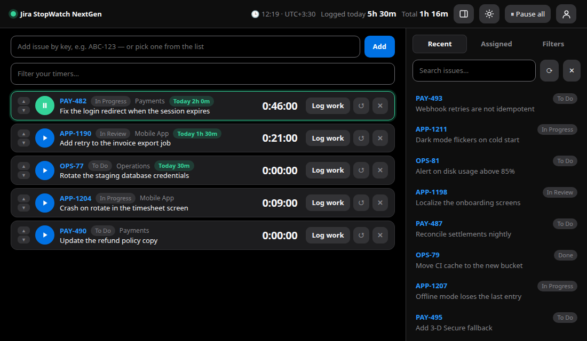
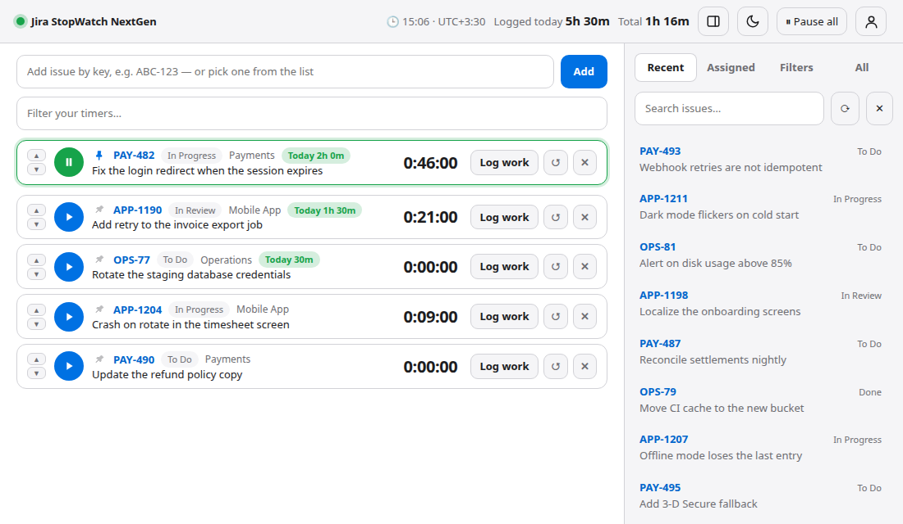

<div align="center">

# JiraStopWatch NextGen

**A fast, modern, cross-platform time tracker for Jira — Windows, macOS and Linux.**

[](https://github.com/farhadrezvani7/jirastopwatch-nextgen/actions/workflows/ci.yml)
[](LICENSE)

[English](README.md) · [فارسی](README.fa.md)



</div>

JiraStopWatch NextGen is built on the core of the open-source [**jirastopwatch**](https://github.com/jirastopwatch/jirastopwatch) project (the Windows desktop stopwatch for logging time on Jira issues). It keeps everything that made the original useful, and then goes further: it has been **upgraded, redesigned, and rewritten in Go** so it is lighter, starts instantly, and runs natively on **Windows, macOS and Linux**.

Start a timer on an issue, work, press **Log work** — the time lands in Jira as a worklog, in *your* time zone, in *your* language.

| Dark | Light | Right-to-left (Persian) |
|---|---|---|
|  |  |  |

**Responsive** — the layout adapts down to phone-width windows; the issue list becomes a slide-over panel.


---

## Install (two clicks)

You only need a Chromium-based browser that is already on almost every computer: **Edge** (pre-installed on Windows 10/11), **Chrome**, **Brave** or **Chromium**. No runtime, no admin rights, no terminal.

Download the file for your system from the [**Releases**](https://github.com/farhadrezvani7/jirastopwatch-nextgen/releases/latest) page:

### Windows
1. Download `jirastopwatch-nextgen-windows-amd64-setup.exe` (use `…-arm64-setup.exe` on ARM PCs).
2. Double-click it → **Next** → **Finish**. You get a Start Menu entry and a desktop shortcut; remove it any time from *Settings → Apps*. To pin it to the taskbar, pin the Start Menu entry (not the open window, which Windows attributes to the browser).
   The first time, SmartScreen may say *“Windows protected your PC”* because the file is not code-signed: click **More info → Run anyway**.

### macOS
1. Download `jirastopwatch-nextgen-macos-arm64.zip` (Apple Silicon: M1–M4) or `…-macos-amd64.zip` (Intel).
2. Open the zip and drag **Jira StopWatch NextGen** into **Applications**.
3. First launch only: the app is signed ad-hoc but not notarized (that needs a paid Apple Developer account), so macOS asks about an "unidentified developer". Open it once, then go to **System Settings → Privacy & Security → Open Anyway**. (On older macOS: right-click the app → **Open**.) If macOS says the app is "damaged", run `xattr -dr com.apple.quarantine "/Applications/Jira StopWatch NextGen.app"` once.

### Linux
- **Ubuntu / Debian / Mint:** download `jirastopwatch-nextgen-linux-amd64.deb` (or `…-arm64.deb`), double-click it and press **Install** in the software center.
- **Fedora / openSUSE:** download the `.rpm` the same way.
- **Any distro, one line** (installs for your user only, no root):
  ```bash
  curl -fsSL https://raw.githubusercontent.com/farhadrezvani7/jirastopwatch-nextgen/main/install.sh | bash
  ```
  Afterwards search for **Jira StopWatch NextGen** in your applications menu. The terminal is only needed for this one command; the app runs on its own.
- Already downloaded the plain `jirastopwatch-nextgen-linux-*` binary? `chmod +x` it and run it with `--install`; remove again with `--uninstall`.

> No Chromium-based browser? The app opens in your default browser instead and quits when you close the tab.

### Updating
Click the profile icon (top right) → **Check for updates**. If a newer release exists, confirm and the app downloads it, verifies its checksum, replaces itself and restarts, with no uninstalling and no manual download. Running timers keep counting. Copies installed system-wide (e.g. from a `.deb`/`.rpm` in `/usr/bin`) ask for your administrator password (polkit/`pkexec`) to replace the file; if `pkexec` isn't available the dialog links to the download page instead.

### Build from source (any OS)
```bash
git clone https://github.com/farhadrezvani7/jirastopwatch-nextgen.git
cd jirastopwatch-nextgen
go build -o jirastopwatch-nextgen .        # needs Go 1.24+
./jirastopwatch-nextgen
```
On Windows run `.\install.ps1` to also get a Start Menu shortcut; `./build-all.sh` cross-compiles every platform and builds the installers into `dist/` (needs `nfpm`, `makensis` and `zip` for the installers).

---

## First sign-in (1 minute)
1. Enter your Jira address (e.g. `yourcompany.atlassian.net`).
2. Get a token:
   - **Jira Cloud:** open <https://id.atlassian.com/manage-profile/security/api-tokens> → *Create API token*. Sign in with your email + that token.
   - **Jira Server / Data Center:** your avatar → *Profile* → *Personal Access Tokens* → *Create token* (or use username + password).
3. Leave **Remember me** ticked (the default) and the app signs you in automatically next time; untick it on a shared computer.
4. Add issues by key (`ABC-123`), by pasting a Jira link, or by picking them from *Recent / Assigned / Filters*.

---

## What's new compared with the original jirastopwatch

The original is a C# / WinForms / .NET Framework desktop app for Windows. NextGen keeps its core workflow and improves almost everything around it.

| | Original jirastopwatch | **JiraStopWatch NextGen** |
|---|---|---|
| **Platforms** | Windows only | **Windows, macOS, Linux** (x64 and ARM) |
| **Technology** | C#, WinForms, .NET Framework, RestSharp | **Go**, one self-contained binary, embedded web UI |
| **Install** | MSI installer + .NET runtime | **Download one file and run it** — no installer, no runtime |
| **Footprint** *(measured on Linux)* | — | ~6.5 MB binary · server ready in ~40 ms · ~10 MB RAM for the server process (the browser window is extra) |
| **Interface** | WinForms window | **Redesigned** modern UI with **light & dark themes**, live clock |
| **Languages** | English | **41 languages**, searchable, with full **right-to-left** layout (Persian, Arabic, Urdu, Hebrew, Kurdish, Pashto) |
| **Time zone** | Computer's local time | **Pick a country (all 247) → worklogs use its time zone** — no more manual +3:30 maths |
| **Sign-in** | Username + API token | **Cloud** (email + API token), **Server/DC personal access token**, or username + password |
| **Jira Cloud compatibility** | Needs patches for current Cloud (removed search API, silent login redirects) | Built in: v3 search endpoint, login-redirect / HTML-login detection, URL clean-up |
| **Search** | Jira issue search | Jira issue search **plus** searchable language / country / zone pickers, favourite-filter search and a filter box for your own timers |
| **Log work** | Time, comment, estimate | Same, **plus** change the issue's status in the same step and see the remaining estimate (and what *Auto* will leave) |
| **Local safety** | — | Server binds to `127.0.0.1` only, per-launch secret token, DNS-rebinding (Host) check |
| **Data files** | Binary-serialised settings | Human-readable JSON, written atomically, owner-only permissions |
| **Tests** | NUnit | Go tests, run by CI on **Windows, macOS and Linux** |

### Everything from the original that is kept
Multiple stopwatches · reorder with ▲▼ · pause others when one starts · edit time · remaining-estimate adjustment (auto / leave / set to / reduce by) · post the note as worklog comment, separate comment, or both · move an issue to e.g. *In Progress* when its timer starts · pause on lock · choose what happens on exit · keyboard shortcuts · optional update notice · max. 20 issues · Apache 2.0.

---

## Features

- ⏱ **Timers that never lose time** — they keep counting while the window is closed and are restored on the next start. Unsent notes are kept too.
- 🌍 **Time zone by country** — all 247 countries; multi-zone countries (US, Russia, Brazil, …) get a zone picker. Worklog start time and the header clock follow it. The default is your computer's own zone, and times are sent to Jira with an explicit UTC offset, so they are right wherever you are.
- 🗣 **41 languages** — English, فارسی, العربية, اردو, کوردی, پښتو, עברית, Türkçe, Azərbaycanca, Русский, Українська, Español, Português, Français, Deutsch, Italiano, Nederlands, Polski, Čeština, Slovenčina, Română, Ελληνικά, Magyar, Български, Српски, Hrvatski, Svenska, Dansk, Suomi, Norsk, 中文, 日本語, 한국어, हिन्दी, বাংলা, தமிழ், Bahasa Indonesia, Bahasa Melayu, ไทย, Tiếng Việt, Kiswahili. Choosing a country suggests its main language.
- 🎨 **Light & dark themes** — switch from the header, the sign-in page or Settings; *Auto* follows your OS.
- 🔎 **Search where you need it** — language, country and zone pickers (accent-insensitive; countries match English, localized and native names), your favourite Jira filters, your timer list, and Jira issues.
- 🔒 **Pause on lock** — pause running timers when the computer locks and optionally resume on unlock (Linux with systemd-logind, Windows, macOS).
- 🔗 **Paste a Jira link** — `Ctrl+V` anywhere adds the issue from a `/browse/ABC-123` or board URL.
- 🕒 **Jira server-clock aware** — Jira stores the exact moment, but its reports group days by the *server's* time zone. If that differs from yours (and from your Jira profile), the app tells you and lets you opt in to writing your local clock time on the server's clock so reports land on the right day; switch back in Settings any time (the app also offers it once the server's zone is fixed).
- 🔑 **Stays signed in** — your token is kept in the system credential store and the app signs you in on launch.
- 📊 **Logged today** — the header shows everything you have logged in Jira today (all issues, in your chosen time zone) and each card shows what you logged on that issue today, so even many worklogs on one ticket add up at a glance.
- 🔁 **Log & start again** — a button in the log dialog books the worklog and immediately restarts the same issue's timer, no searching needed.
- ✋ **Drag and drop** — press and hold a card, then drag it to a new place (▲▼ and `Ctrl+↑/↓` still work).
- 🎛 **Look, your way** — in *Settings* pick the base font size (10–16 px, previewed live) and switch soft drop shadows on or off (off by default).
- 👤 **Profile window** — the header shows just a profile icon; click it to see who is signed in, toggle *pause others*, open Settings, check for updates or sign out.
- 📱 **Responsive & compact** — the layout adapts down to phone-width windows (the issue list becomes a slide-over panel), and slimmer cards and a one-row header fit more without scrolling. The issue panel can be collapsed on wide windows too.
- 🔔 **Tray icon** — on Windows and on Linux desktops with a tray: quick access to the window, running-timer tooltip, pause all, quit (see [Tray icon](#tray-icon)).
- ⬆️ **One-click updates** — *Check for updates* downloads, verifies and installs the new version for you.

### Keyboard shortcuts (same as the original)
| Keys | Action | Keys | Action |
|---|---|---|---|
| `Ctrl+P` | Start / pause | `Ctrl+↑` / `Ctrl+↓` | Move issue |
| `Ctrl+L` | Log work | `Ctrl+O` | Open in Jira |
| `Ctrl+E` | Edit time | `Ctrl+I` / `Ctrl+N` | Focus “add issue” |
| `Ctrl+R` | Reset timer | `Ctrl+C` | Copy issue key |
| `Ctrl+Del` | Remove | `Ctrl+V` | Add pasted key / link |

---

## Privacy & security
- Your data goes **only to your own Jira site** — nothing else is contacted (the update check, which asks GitHub for the latest release, is off unless a release repo is configured at build time and can be switched off in Settings; a new version is only downloaded after you confirm).
- The local web server listens on `127.0.0.1` on a random port and requires a per-launch secret, so other websites and other users of the machine cannot talk to it.
- If **Remember me** is ticked, the token is kept in your operating system's credential store: Windows Credential Manager, the macOS Keychain, or the Linux Secret Service (GNOME Keyring / KWallet; needs the `secret-tool` command from `libsecret-tools`). If none is available, it falls back to a file in the app's config folder that only your user can read, **not** encrypted. Old versions' plain-text tokens are moved into the credential store automatically. On shared computers leave *Remember me* off.
- Config and timers live in `~/.config/jirastopwatch-nextgen` (Linux), `%AppData%\jirastopwatch-nextgen` (Windows) or `~/Library/Application Support/jirastopwatch-nextgen` (macOS).

## Not included (compared with the original)
The diagnostic log file, and a tray/menu-bar icon on macOS (Windows and Linux have one: see below).

## Tray icon
On Windows and on Linux desktops with a status-notifier tray (KDE, XFCE, Cinnamon, GNOME with the AppIndicator extension) the app adds a notification-area icon. Click it to open the window; the tooltip shows the running timer, and the menu has *Open*, *Pause all timers* and *Quit*. With a tray icon, closing the window keeps the app (and your timers) running in the tray; use *Quit* to exit. Without a tray, closing the window quits as before.

## Development
```bash
go test ./...                 # unit tests
go run . -no-open             # print the URL instead of opening a window
VERSION=1.0.0 UPDATE_REPO=farhadrezvani7/jirastopwatch-nextgen ./build-all.sh   # release binaries + SHA256SUMS in dist/
```
- **Add or fix a language:** each language is `web/lang/<code>.json` (same keys as the English text in `web/i18n.js`). Add the code to `LANGS` in `web/i18n.js`; `go test` verifies that every declared language has every key. Missing keys fall back to English.
- **Releases:** pushing a tag like `v1.0.0` makes GitHub Actions build all platforms and publish them.

## About the author
Built and maintained by **Farhad Rezvani** — mobile developer (Flutter is my main craft), also working with Go, Rust and C#, and with SQL and PostgreSQL databases.
GitHub: [@farhadrezvani7](https://github.com/farhadrezvani7) · Telegram: [@farhad_rezvani](https://t.me/farhad_rezvani)

## Support & upgrades
Having a problem, or need an upgrade or a new feature in this project? Message me on Telegram: **[@farhad_rezvani](https://t.me/farhad_rezvani)**. You can also open an [issue](https://github.com/farhadrezvani7/jirastopwatch-nextgen/issues) on GitHub.

## License & credits
Licensed under the **Apache License 2.0** (see [LICENSE](LICENSE) and [NOTICE](NOTICE)).

Based on [jirastopwatch](https://github.com/jirastopwatch/jirastopwatch) — © 2016 Carsten Gehling, © 2020 Dan Tulloh, © 2023 Y. Meyer-Norwood and contributors. Thank you for the original idea and the excellent core.

“Jira” and “Atlassian” are trademarks of Atlassian. This project is not affiliated with or endorsed by Atlassian.
